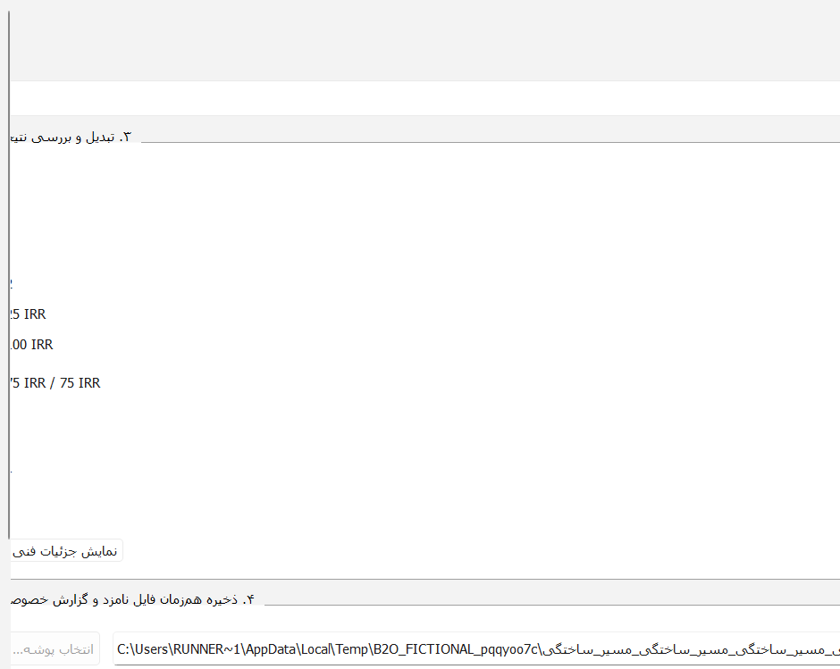
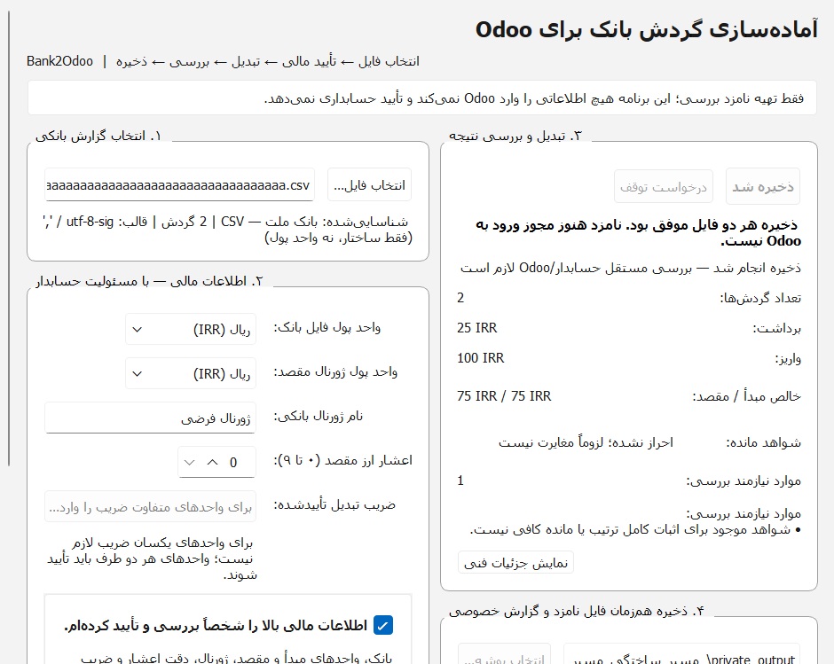
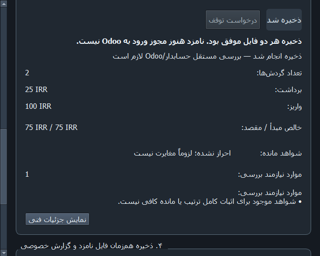

# Qt saved-path overflow: synthetic Windows QPA measurements

Review-only diagnostic and correction of Draft PR #10; no real bank files.
Original-size Qt QWidget PNGs included. Contact sheets are resized overview.
Exact verified checkout: 601094615243d8918e5f51c045077bcd159ec298
Qt QPA windows, simulated Light/Dark. NOT a physical Windows 11 acceptance.

| Scheme | Requested | Actual | Viewport | H-scroll original PR10 | H-scroll fixed | H-scroll injected old label |
|---|---|---|---|---:|---:|---:|
| light | 940x830 | [940, 749] | [928, 749] | 1483 | 0 | 1540 |
| light | 650x520 | [650, 520] | [638, 520] | 1306 | 0 | 1355 |
| light | 600x480 | [600, 480] | [588, 480] | 1355 | 0 | 1412 |
| dark | 940x830 | [940, 749] | [926, 749] | 1474 | 0 | 1527 |
| dark | 650x520 | [650, 520] | [636, 520] | 1301 | 0 | 1357 |
| dark | 600x480 | [600, 480] | [586, 480] | 1354 | 0 | 1419 |

Actual PRE-FIX PR10 images: CI 41183845090, original unmodified product plus test-only probe.

Root cause 1: unbounded full mixed-script path displayed by wrapped QLabel inflates minimum column width.
Root cause 2: overly long saved-button caption independently inflates wide results column.
Remedy: short saved status, full paths in separate bounded read-only selectable LTR QLineEdits, short saved action.
Expected-red automated regression: run 41184158401; fixed result: current PR #11 checks.
NOT PROVEN: accountant Windows 11, physical DPI at 100/125/150%, AT/user acceptance.
